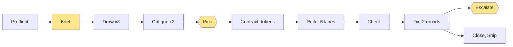

# I stopped chaining design skills by hand. The first run still failed, on purpose.

A fork of this starter looks like the starter. Neutral grey tokens, Inter, no `PRODUCT.md`, no `DESIGN.md`. Giving it a brand used to be my job, and I was bad at it in a specific way: I was the bottleneck.

## Before: I was the sequencer

`AGENTS.md` lists the lanes for any frontend task. A lead skill for direction. Another for critique. A finish pass. A motion pass. Each skill owns one lane, and the file says never to run two leads on one surface. For a brand, that means I had to remember the order:

1. `impeccable` init, to interview me and write `PRODUCT.md`.
2. The taste skill's `draw.mjs`, to deal directions.
3. A comp for each direction, then the taste critique loop on each.
4. `impeccable` critique, then `emil-design-eng` and `animate` for motion.
5. A pick, through `brain review`.
6. `impeccable` polish, then `document` to write `DESIGN.md`.

Miss a step and nothing stops me or records it. Every surface was designed by hand, so the plan for this workflow says the number of times the human gets asked has no bound. I have no count of how many times I was asked, so I will not invent one.

What I do have is the 2026-07-30 postmortem. The first `/demo` surface "passed every gate the repo had": typecheck, 269 unit tests, build, e2e 6/6, a browser walk, two independent worker walks, and a Greptile review at 3/5. The postmortem also says it was "still generic slop". It failed six checks in the anti-slop reference, a file that "nothing in the process required anyone to read". Its own summary of the cause: "A functional gate cannot catch a design defect."

A later pass cleared the checklist and I called it "lame and boring as hell". The checklist only measures ways to be bad.

So the old process had three faults. I sequenced from memory. Nothing recorded the sequence. And no gate was allowed to fail a design for looking generic.

## After: a script holds the order, and I hold three decisions

`.claude/workflows/brand-init.js` is one workflow with eleven phases: Preflight, Brief, Draw, Critique, Pick, Contract, Build, Check, Fix, Close, Ship. The agents do the skill-chaining. I answer through `brain review`, a page in my browser that the agent opens and then waits on.

The three human moments are the brief, the pick, and an escalation. The plan's success metric was at most three asks after the interview. The pick card also asks whether to rebuild the home page, so that question costs no extra ask.

The ordering rule that makes it safe: after one sequential step that writes the tokens, the lanes own disjoint files. The workflow compares each lane's report and the git diff against those fences. A lane that edits outside its fence is a P0.

## What the second run did

I ran it twice.

**Run 1 lasted about 39 seconds.** Preflight used one agent and refused to start, because the baseline was red: `harness-check.sh` exited 1, eight checks passed and one failed. Typecheck and tests were fine. The harness failed because a worktree has no `.brain/brain.db` of its own. Commit `3b81ca2` fixes that. A red baseline stopped the run before it spent anything on design.

**Run 2 was the full run.** 52 agents, 915 tool calls, 3,315,443 tokens, 3h37m on the clock.

- Three comps came back. The taste critic scored them 7.1, 7.2 and 7.3. All three sit under the 7.5 bar, and the workflow logged them "reported as scored", not rounded up.
- I picked comp 1. The other two had reasons against them on file: a motion check that failed because reduced motion still played the toast slide, and a dark primitives strip that rendered as an empty void.
- Six build lanes ran at once. The Build phase took about 19 minutes of wall clock. Added together, the six lanes ran about 95 minutes, so parallel work bought roughly a fivefold saving there. No lane broke a fence.
- Checks found 18 open P0/P1 findings. Fix round 1 left 7. Fix round 2 left 4. The workflow escalated those 4 to me. I answered with one line: stop. My note said the site runs edge to edge on large desktops, which nobody had checked past 1440 pixels.
- `ship` reads `shipped: false`. There is no `DESIGN.md`.

The home page scored 6.9 against 7.5. The workflow did not round it up. That is the bar doing its job.

## What the synthesis found

The last agent read both trees and the logs and wrote down what was wrong. It was not flattering.

- **The run split in two.** One trial worktree held the tokens, all six primitive lanes, the wordmark and `PRODUCT.md`. The main checkout held a hand-patched subset. The critics scored the main checkout, so the 59 rebuilt files in the worktree were never critiqued.
- **The contrast-audit script is broken.** `scripts/design-audit.ts` paints black before it reads a transparent background, so every ghost button measures 1.79:1 and fails. Six lanes hit it on their own. Contrast was checked by hand, never by the gate.
- **`<Toaster />` is mounted in neither tree.** Every `toast()` renders nothing, so nobody saw the restyled toast.
- The wordmark appears on no app screen, and `DESIGN.md` exists nowhere.

The old process gave me a page that passed every gate. This one gave me a list I can act on.

## Before and after

| | Before | After |
|---|---|---|
| Who sequences the skills | Me, from memory | The script |
| Human touchpoints | Unbounded; I have no count | 3: brief, pick, escalation |
| What is recorded | Whatever I wrote down | Per-agent logs, scores, verdicts, fence checks, synthesis |
| What is measurable | Gates that pass a generic page | Taste scores against 7.5; open P0/P1 per round (18, 7, 4) |
| Cost | No number | 52 agents, 3,315,443 tokens, 915 tool calls, 3h37m wall clock |

## How much of 3h37m was me

Each agent in the log has a duration. Two of them waited on me: `pick:round-1` (787,804 ms) and `fix:escalation:post-fix` (7,577,157 ms). Together that is 8,364,961 ms, or 139 minutes, 64 percent of the 13,008,328 ms total. The rest, about 77 minutes, is machine time.

That is an upper bound. The escalation agent also did some work while it waited, and I did not split the two. The log shows no timing for my brief, because ten agents in run 2 came from an earlier attempt and the log marks them cached. So the 3h37m covers the pick and the escalation, not the interview.

The machine worked about an hour and a quarter and waited two hours for me.

## What I take from it

The run did not ship, and that is the result I wanted from a first run. Both critics held the bar. The workflow stopped at a human, not at a green check. Every defect has an owner and a fix. Some need a lane that does not exist yet, such as one for locale copy and one for the app shell.

What I changed after reading it: `79ce544` lets the pick accept a free-text "LGTM" and reopens a review that ended. It also routes motion review through `emil-design-eng`, because `review-animations` is user-only, so every motion critic returned FAIL without looking.

The fixes landed the same day. Every agent now works inside one absolute repo root that preflight pins, and a lane that reports from another checkout counts as a P0. A new shell lane owns the sidebar, the auth shell and the brand copy, and one late lane picks up findings no fence owns. Critics refuse to judge without the comp and PRODUCT.md, browser checks run one at a time, and the critics look at 1920 wide. The audit script now composites clear backgrounds instead of reading them as black, and it can sign in. The Toaster is its own task. Then I can compare run 3 to run 2 with numbers, which I could never do before.
