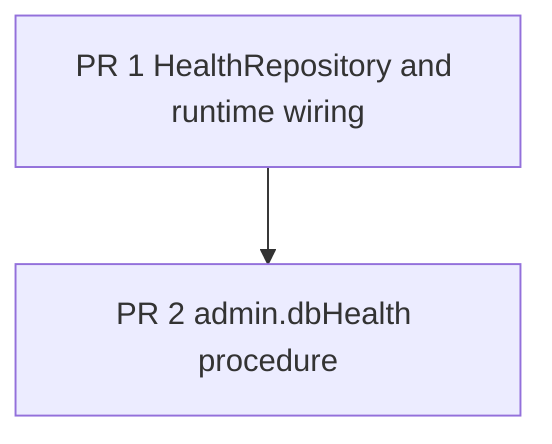

# Admin database health check

## Summary
An admin can ask the app whether its D1 database answers, and how fast. One admin-only tRPC query,
`admin.dbHealth`, runs a trivial query against D1 and returns `{ ok, latencyMs, checkedAt }`. A failed
query returns `ok: false` with the error's tag instead of throwing, so a caller can show a red status.

## Context
- Admin procedures already sit behind `adminProcedure`, which rejects non-admins with FORBIDDEN — source: app/trpc/index.ts
- Repositories are Effect services wired into one runtime layer — source: app/runtime.ts
- D1 failures already map to the `QueryError` tagged error — source: app/models/errors/repository.ts
- Every procedure runs through `runProcedure` with a span name — source: app/trpc/routes/admin.ts

## User and job
An admin or operator of a fork. Job: confirm the database is reachable after a deploy or a migration,
without opening the Cloudflare dashboard.

## Fit
Fits. The starter ships an admin area and tracing; a database health check is a small, common need and a
clean, backend-only feature to exercise the ship-feature workflow end to end.

## Success metric
The check answers in under 200 ms at p95 on a healthy preview database, read from the `trpc.admin.dbHealth`
span. Baseline: none; target: p95 < 200 ms.

## Non-goals
- A UI card on the admin dashboard — a follow-up once the procedure exists
- Checking R2, Workflows or third-party services — the database only
- A public, unauthenticated health endpoint — this is admin-only

## Architecture
New `HealthRepository` Effect service in `app/repositories/health.ts` with one method, `pingDatabase()`,
which runs `select 1` through Drizzle on the `DATABASE` binding, times it, and returns
`{ ok: true, latencyMs }`; a D1 failure becomes `{ ok: false, latencyMs, error: "QueryError" }`.
It is added to the repositories layer in `app/runtime.ts`. Unit test with a stubbed database.
New procedure `admin.dbHealth` (adminProcedure, query, no input) in `app/trpc/routes/health.ts`, merged
into the admin router in `app/trpc/routes/admin.ts`, span `trpc.admin.dbHealth`. No new tables, no seed
fixtures, no new tagged errors.

## Decisions
### D1 — Does a failed check throw or return a status?
- **Area:** backend
- **Chosen:** Return `{ ok: false, error }`
- **Rejected:** Fail with `QueryError` — the caller wants a status to show, not an error toast
- **Why:** A health check that reports failure as data is easier to display and to alert on.
- **Decided by:** agent

### D2 — Where does the procedure live?
- **Area:** backend
- **Chosen:** Under the admin router, from its own route file
- **Rejected:** A new top-level `health` router — one more namespace for one procedure
- **Rejected:** A public procedure — it would expose database latency to anyone
- **Why:** It is an admin tool, and its own file keeps admin.ts from growing.
- **Decided by:** agent

## Flow


## PR stack
| # | Branch | Base | Fence | Size | Greptile focus |
|---|--------|------|-------|------|----------------|
| 1 | feat/admin-db-health/1-data | main | `app/repositories/health.ts`, `app/repositories/__tests__/health.test.ts`, `app/runtime.ts` | S | Latency timing and the failure-as-data mapping |
| 2 | feat/admin-db-health/2-api | feat/admin-db-health/1-data | `app/trpc/routes/health.ts`, `app/trpc/routes/admin.ts` | S | Admin-only guard and span name |

## Contract
```ts
export interface DbHealth { ok: boolean; latencyMs: number; checkedAt: string; error?: string }
// HealthRepository.pingDatabase() -> Effect<{ ok: boolean; latencyMs: number; error?: string }>
// admin.dbHealth() -> DbHealth   (adminProcedure, query, no input)
```

## Open questions
- Should a later UI card poll this, or check once on load?
