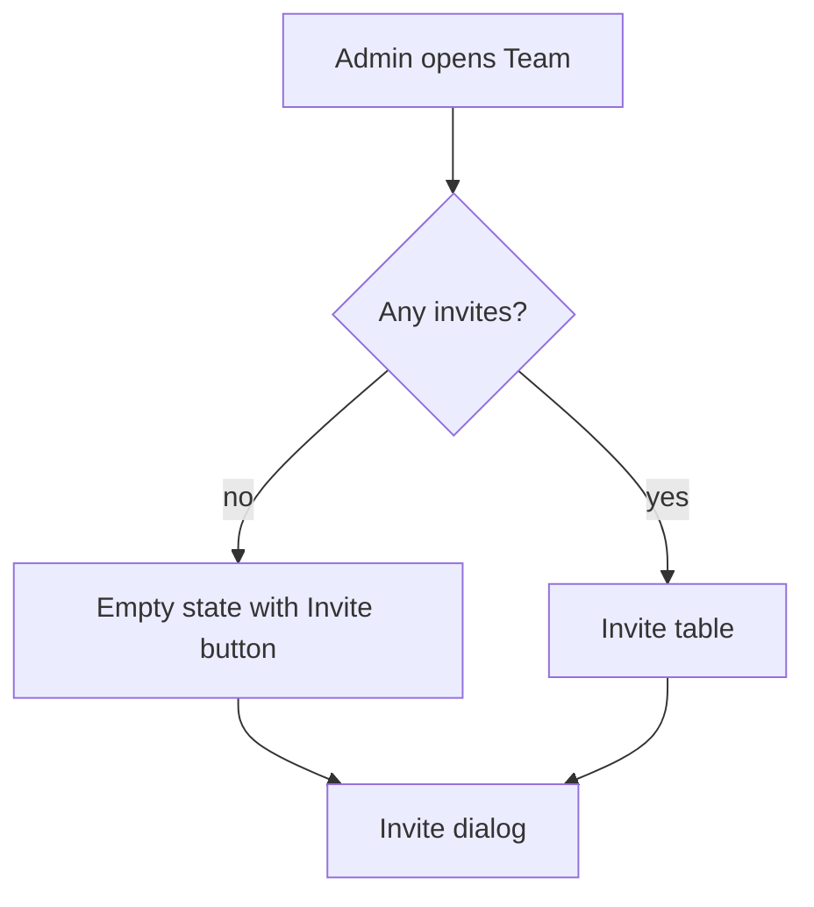
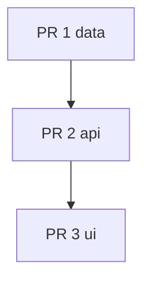

# Team invites

## Summary
An admin invites a teammate by email. The invitee follows a link, sets a password and lands in the team.
Invites expire after seven days and an admin can revoke one at any time.

## Context
- The users table has no team column yet — source: app/db/schema.ts
- Email sending already runs through one Effect service
- Admin tables share one pagination helper — source: ADR docs/adr/admin-tables

## User and job
Team admin on a paid plan. Job: add a colleague without sharing a password.

## Fit
Fits. The starter ships auth and an admin area, and invites are the first step toward teams.

## Success metric
Share of invites accepted within seven days. Baseline none, target 60%, read from the invites table.

## Non-goals
- Bulk CSV import — one at a time covers the first release
- Role picker per invite — every invitee joins as member

## UX


| Screen | Empty | Loading | Error | Success |
|--------|-------|---------|-------|---------|
| Team invites | Prompt to invite | Row skeletons | Retry banner | Toast and new row |

### Prototypes
- a — Table with inline revoke — `plans/team-invites-proto-a.html`
- b — Card list with invite drawer — `plans/team-invites-proto-b.html`
- c — Single form above the members list — `plans/team-invites-proto-c.html`

Chosen: a

## Architecture
New `invites` table (id, email, token hash, expiresAt, revokedAt). One repository, three procedures:
`invites.create`, `invites.revoke`, `invites.list`. Tagged errors: `InviteExpired`, `InviteNotFound`.
Spans on each repository method. Seed fixtures: one pending, one expired, one revoked invite.

## Decisions
### D1 — How does the invitee prove the email?
- **Area:** backend
- **Chosen:** Signed single-use token in the link
- **Rejected:** Six-digit code — a second screen for no gain in safety
- **Why:** The link already travels by email, so the token adds nothing the inbox lacks.
- **Decided by:** agent

### D2 — Where do invites live in the UI?
- **Area:** ux
- **Chosen:** A tab on the Team page
- **Rejected:** A modal from the header — it hides the pending list
- **Rejected:** A separate route — one more nav item for one table
- **Why:** The admin wants the list next to the members.
- **Decided by:** user

## Flow


## PR stack
| # | Branch | Base | Fence | Size | Greptile focus |
|---|--------|------|-------|------|----------------|
| 1 | feat/team-invites/1-data | main | `app/db/schema.ts`, `app/repositories/invites.ts` | M | Token hashing, expiry maths |
| 2 | feat/team-invites/2-api | feat/team-invites/1-data | `app/trpc/routes/invites.ts` | S | Admin-only guard |
| 3 | feat/team-invites/3-ui | feat/team-invites/2-api | `app/routes/team/` | M | State coverage, i18n keys |

## Contract
```ts
export interface Invite { id: string; email: string; expiresAt: Date; revokedAt: Date | null }
// invites.create({ email }) -> Invite
// invites.revoke({ id }) -> void
// invites.list() -> Invite[]
```

## Open questions
- Should a revoked invite email the invitee?
